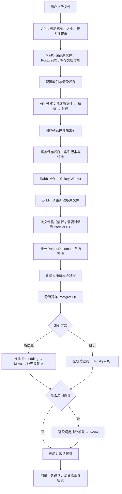

# 文件上传、解析、索引与检索整体链路

更新日期：2026-10-28。本文按当前代码说明文件从上传到可检索的处理过程，
并区分 API 预览与 Worker 正式索引。配置默认值、部署覆盖值和历史现场数据分别说明。

## 1. 整体流程

主控制台流程为：上传原文件 → 配置规则 → 预览 → 确认任务 → 后台正式索引
→ 校验并激活 → 检索。

“解析”负责从文件中提取文字、结构和来源信息；“索引”还需要执行分段、
关键词处理、向量化、存储写入，以及启用时的图谱抽取。



这是控制台主路径。API 也提供直接提交规则与任务的入口，不要求所有调用者
先执行预览；`/ingest` 还可在一次请求中组合上传、规则确认和任务投递。

## 2. 上传：校验并保存原文件

上传接口：

```text
POST /api/knowledge_base/{dataset_id}/documents
POST /api/knowledge_base/{dataset_id}/documents/upload
```

主要步骤：

1. 确认知识库存在，检查扩展名白名单。
2. 校验 MIME 类型与文件签名，检查文本样本是否明显为二进制。
3. 按数据块读取文件，检查大小并计算 SHA-256。
4. DOCX、XLSX 额外检查 ZIP 容器条目、加密、路径、解压大小和压缩比等。
5. 在知识库内按文件摘要和名称检查重复文件。
6. 将原文件上传 MinIO，创建 PostgreSQL `documents` 记录，初始状态为 `waiting`。

文档记录保存名称、大小、MIME、SHA-256、bucket 和 object key 等信息。
普通上传接口不立即执行全文解析，也不自动创建索引任务；处理规则确认后才投递。
原文件上传成功而文档记录创建失败时，服务会尝试删除本次对应的 MinIO 对象。

代码：[上传接口](../rag_modules/api/file_api.py)、
[上传服务](../rag_modules/services/document_service.py)、
[文件校验](../rag_modules/documents/validation.py)。

## 3. 预览：在 API 中执行真实解析和分段

```text
POST /api/knowledge_base/{dataset_id}/indexing/preview
```

API 根据文档记录从 MinIO 读取原文件，调用正式解析器和分段器，返回分段内容、
来源信息、警告和分段总数。预览不执行 Embedding、Milvus 写入或图谱抽取，
也不把预览分段作为正式索引结果持久化。

```text
原文件字节
  → ParserRegistry.parse
  → ParsedDocument
  → Segmenter.segment
  → PreviewResponse
```

预览默认最多处理 20 个文档、返回前 100 个分段，超时为 30 秒。
当前实现先完成解析和分段，再截取返回内容；只展示 100 段不代表只计算 100 段。

**预览产物不直接复用于正式索引。** 确认后 Worker 会重新读取原文件、重新解析
和分段；图片或扫描页在两个流程中都可能调用 OCR。

代码：[预览接口](../rag_modules/api/indexing_preview_api.py)、
[预览服务与 `_parse_and_segment`](../rag_modules/services/preview_service.py)。

## 4. 确认规则：创建索引版本和持久任务

控制台确认入口：

```text
POST /api/knowledge_base/{dataset_id}/indexing/configure
```

另一个创建任务入口为 `POST /api/knowledge_base/{dataset_id}/indexing/jobs`。
它们均调用 `ProcessRuleService.confirm`，校验所选文档、索引方式、模型和分段规则。
父子分段要求高质量索引，经济索引只支持普通分段。

| 数据表 | 此阶段作用 |
|---|---|
| `dataset_process_rules` | 创建或复用不可变处理规则，并绑定所选文档 |
| `dataset_indexes` | 创建 `building` 状态的目标索引版本 |
| `indexing_jobs` | 保存总任务、索引方式、模型和分段配置快照 |
| `indexing_job_documents` | 为每个文档创建执行项，保存进度、尝试次数和错误等 |

数据库事务提交后，再向 RabbitMQ 投递文档任务标识。文件内容和模型凭据不放入任务消息。
投递失败时保留持久任务，维护任务负责后续补投。

`POST /api/knowledge_base/{dataset_id}/ingest` 可以组合上传与确认步骤，
随后进入相同的后台索引流程。

代码：[确认接口](../rag_modules/api/indexing_configuration_api.py)、
[规则服务](../rag_modules/services/process_rule_service.py)、
[组合摄取入口](../rag_modules/api/ingest_api.py)、
[任务发布器](../rag_modules/tasks/publisher.py)。

## 5. 正式解析：Worker 读取原文件并按格式分派

Celery Worker 根据文档任务标识加载数据库配置并领取任务，通过心跳维护租约。
对于普通原文件索引，Worker 从 MinIO 读取文件，再交给 `ParserRegistry`。
对于保存分段修订触发的任务，索引引擎可以直接使用修订分段，跳过原文件解析和重新分段。

| 文件类型 | 解析器 | 提取方式与主要来源信息 |
|---|---|---|
| TXT | `TextParser` | 解码、规范化换行、按空行组织段落，保留行号 |
| Markdown | `MarkdownParser` | 标题、段落、列表、代码、表格等，保留标题路径与行位置等 |
| DOCX | `DocxParser` | 读取正文段落和表格，保留标题路径等 |
| XLS | `XlsParser` | 使用 xlrd 读取可见工作表，以表头组织数据行 |
| XLSX | `XlsxParser` | 检查工作表 XML，使用 OpenPyXL 读取可见工作表和单元格 |
| CSV | `CsvParser` | 解码、识别分隔格式，以表头组织数据行 |
| PDF | `PdfParser` | 使用 pypdf 逐页提取文本；无有效文本时可渲染并 OCR |
| PNG、JPG、JPEG | `ImageParser` | 解码图片后调用 PaddleOCR，清洗后生成段落 |

Excel 和 CSV 的数据行被转换为“列名：值”的文本，并携带工作表与行位置。
XLSX 不计算公式；优先采用可用缓存值，没有缓存时保留公式文本并产生警告。

### 5.1 OCR 的触发与清洗

启用 `PARSER__OCR_ENABLED=true` 且依赖可用时：

- PNG、JPG、JPEG 直接识别。
- PDF 按页判断，只有提取不到有效文本的页面才渲染为图片并识别。
- 同一 PDF 的文本页和扫描页可以分别走文本提取与 OCR。
- 同一页只要存在有效文本层，当前不会额外识别其中图片里的文字。

OCR 引擎在第一次识别时初始化。结果会过滤低置信度、空白与噪声文字，规范化
字符与空白，并按文字框间距组织段落。PDF 还会识别并清理符合规则的重复页眉页脚。
保留的元数据包括页码、OCR 标记、置信度和受数量限制的文字框。

### 5.2 统一解析结果

```text
ParsedDocument
├── document_id、filename、source_type
├── blocks: ParsedBlock[]
│   ├── block_type：paragraph / heading / list_item / code / table_row
│   ├── text：提取出的文字
│   └── metadata：页码、行号、工作表、标题路径或 OCR 信息等
├── metadata：文档级信息
└── warnings：非致命问题
```

后续分段器消费统一结果，无需再理解 PDF、DOCX 等原始格式。
元数据按解析器能力提供，不保证每个格式都有全部定位字段。

代码：[解析器分派表](../rag_modules/parsing/factory.py)、
[注册表](../rag_modules/parsing/registry.py)、
[解析结果模型](../rag_modules/parsing/models.py)、
[OCR 清洗](../rag_modules/parsing/ocr_cleaning.py)。
安装与详细规则见 [PaddleOCR 说明](paddleocr.md)。

## 6. 分段：转换成检索单元

普通分段根据长度、重叠和分隔符切分文本，各段独立建立索引。
父子分段保留较大的父段上下文，再生成较小的子段；子段用于向量召回，
父段不生成向量，检索命中子段后可以返回对应父段正文。

分段携带来源元数据；索引任务将结果暂存到 PostgreSQL `document_segments`，
初始仍属于正在构建的索引，尚未对正常检索发布。

代码：[分段器](../rag_modules/segmentation/segmenter.py)、
[分段持久化](../rag_modules/repositories/segment_repository.py)。

## 7. 建立索引：向量、关键词与图谱

### 7.1 高质量索引

```text
可索引分段（父子模式只取子段）
  → 分批调用 OpenAI-compatible Embedding 接口
  → 验证返回数量和向量维度
  → 根据索引版本准备对应 Milvus collection
  → 写入分段向量和关联标识
  → 标记该批分段的 Embedding 完成
  → 下一批
  → 为缺失关键词的分段提取并保存关键词
```

首次需要解析向量目标时，使用真实返回维度锁定 collection 维度；后续批次必须一致。
分段 ID 在 PostgreSQL 和 Milvus 中对齐，向量记录还携带知识库、文档、索引版本、
父段和位置等关联信息。当前引擎按批等待处理完成后再执行下一批。

### 7.2 经济索引

提取关键词并保存在 PostgreSQL，不调用 Embedding、不创建向量。
高质量索引也保存关键词，以支持关键词和混合检索。

### 7.3 可选图谱抽取

服务端启用 `GRAPH__ENABLED` 后，在向量或关键词处理完成后，
对可索引分段调用抽取模型，生成实体、属性和关系，校验后写入 Neo4j。
当前为逐段串行调用，正式任务等待图谱处理完成后再报告最终验证完成。

图谱抽取使用聊天补全接口，与 Embedding 使用的向量接口不同。
预览不会执行图谱抽取，普通文件解析本身也不会调用图谱抽取模型。

代码：[索引引擎](../rag_modules/indexing/engine.py)、
[Embedding 客户端](../rag_modules/embeddings/openai_compatible.py)、
[关键词提取](../rag_modules/indexing/keywords.py)、
[Milvus 适配器](../rag_modules/vector_stores/milvus.py)、
[图谱索引](../rag_modules/graph/indexer.py)。

## 8. 校验与激活

任务运行器持久化文档完成、失败或取消状态，再进行总任务汇总和最终校验。
初始构建或全量重建时，等待全部文档任务结束，检查文档分段及 Embedding 状态
满足激活条件后，在事务中发布新版本：

```text
新索引 building → active
新分段 indexing → completed
已有旧索引 active → retired（存在旧版本时）
总任务 → completed
```

未完成或未通过校验的新版本不能发布为有效索引；构建失败时保留已有有效版本。
分段修订等其他任务有对应的激活分支，不能将所有任务都理解为全库版本替换。

代码：[任务运行器](../rag_modules/tasks/indexing_tasks.py)、
[最终校验与激活](../rag_modules/repositories/indexing_repository.py)。

## 9. 检索：只读取有效版本与可见分段

检索服务选择 `active` 索引，并过滤不可见文档和无效分段：

| 模式 | 处理方式 |
|---|---|
| 向量检索 | 查询向量化 → Milvus 相似度召回 → PostgreSQL 取正文与来源 |
| 关键词检索 | 查询关键词提取 → PostgreSQL 匹配分段关键词 |
| 混合检索 | 合并向量与关键词召回并按配置评分 |
| 图谱检索 | Neo4j 召回关联分段 → PostgreSQL 过滤并取正文与来源 |

父子分段命中子段后返回可用的父段上下文，同一父段的多个命中会去重。
接口可以返回文档名、来源信息、得分和匹配方式；证据检索本身不需要聊天生成模型。
此处链路终点是检索证据，不能把返回证据自动视为已经生成完整问答。

代码：[检索接口](../rag_modules/api/retrieval_api.py)、
[检索服务](../rag_modules/retrieval.py)。

## 10. 各组件职责

| 组件 | 职责与保存内容 |
|---|---|
| FastAPI | 上传、预览、规则确认、任务查询与检索接口 |
| MinIO | 原始文件 |
| Parser / PaddleOCR | 提取文字、结构和来源信息 |
| Segmenter | 创建普通分段或父子分段 |
| PostgreSQL | 文档、规则、任务、索引版本、分段正文与关键词 |
| RabbitMQ | 投递 Celery 任务标识 |
| Celery Worker | 执行正式索引、重试和相关维护任务 |
| Embedding 服务 | 将分段或查询转换为向量 |
| Milvus | 保存向量并执行相似度检索 |
| 抽取模型与 Neo4j | 抽取、保存并查询实体关系及其来源分段关联 |

## 11. 限制与耗时排查

代码默认单文件上传限制为 50 MiB，DOCX/XLSX 解压后总大小限制为 200 MiB。
表格默认累计有效行数 100,000、列数 1,000、单元格长度 32,768 字符。
分段器默认源内容预算为 52,428,800 字符、100,000 个内容块，分段数量预算为
10,000 条。父子模式下需要关注父段和子段共同消耗的记录预算。
配置可能由部署环境覆盖，不能只根据文件字数判断完整入库能力。

上传校验按块读取不代表整条链路是流式处理：多个解析器会读取全文或加载工作簿，
注册表也会将不可 seek 的源流读入内存后再分派。超大文件需要考虑内存、分段预算
和任务时限，不能通过扩大上传限制就认为已经支持。

排查缓慢时应分别检查解析、分段、模型推理、写入、图谱抽取和最终激活：

- 预览与正式索引目前重复解析；扫描文件也可能重复 OCR。
- 子段越多，Embedding 和图谱抽取调用量通常越大。
- 当前向量化按批等待，图谱抽取逐段串行执行。
- 当前向量批次进度映射到 70%～95%，不是实际耗时百分比；图谱阶段缺少独立逐段进度。
- Celery 当前软超时 3,500 秒、硬超时 3,600 秒，长文档需要检查完整任务耗时。

2026-10-28 的现场文档包含 3,302 个子分段，本地 BGE 每批 4 段、平均请求约
2.7 秒，向量请求累计时间估算约 37 分钟。这是特定部署的历史快照，不是通用性能指标。
详细证据、进度问题和未解决风险见
[IDX-PERF-001 索引性能记录](superpowers/retrospectives/2026-10-28-indexing-performance.md)。

配置与任务机制：[设置模型](../rag_modules/config/settings.py)、
[Celery 配置](../rag_modules/tasks/celery_app.py)、
[本地模型部署覆盖](../docker-compose.local-models.yml)。
