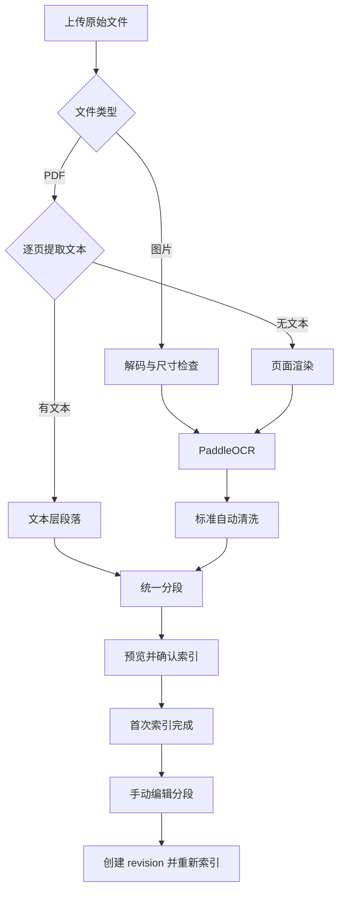

# PaddleOCR 文档解析与清洗说明

本文说明 Graph-RAG 中 PaddleOCR 的安装、配置、使用流程、清洗规则与排障方法，供部署人员、知识库使用者和开发者参考。

## 1. 支持范围

PaddleOCR 用于从图片和扫描版 PDF 中提取文字。识别结果经过标准自动清洗后，进入项目现有的分段、预览和索引流程。

| 输入类型 | 当前处理方式 |
|---|---|
| PNG、JPG、JPEG 图片 | 解码图片，调用 OCR，清洗后生成段落 |
| 有文本层的 PDF 页面 | 优先使用文本层，不调用 OCR |
| 没有可提取文本的 PDF 页面 | 渲染为图片，再调用 OCR |
| 同时包含文本页和扫描页的 PDF | 按页选择文本提取或 OCR，保留页码 |
| TXT、Markdown、DOCX、XLS、XLSX、CSV | 沿用各格式原有解析器 |

目前新增的图片扩展名为 `.png`、`.jpg`、`.jpeg`。上传阶段检查扩展名、MIME 类型、文件签名和大小；解析阶段进一步检查图片能否解码、宽高和像素总量。若部署中自定义了上传扩展名白名单，也需要允许这些图片格式。

OCR 默认关闭，相关依赖按需安装。已有文本层的 PDF 和其他常规文档可以继续使用基础解析流程。

## 2. 安装与启用

### 2.1 CPU 环境

项目要求 Python 3.11 或更高版本；实际可用版本还取决于 PaddlePaddle 对操作系统、处理器架构和 Python 版本的支持。在项目根目录，使用 API 和 Worker 实际运行的 Python 环境安装：

```bash
python -m pip install -e '.[ocr]'
```

可选依赖定义在 [pyproject.toml](../pyproject.toml)：

| 依赖 | 当前声明范围 | 用途 |
|---|---|---|
| `Pillow` | `>=10,<13` | 图片解码与颜色转换 |
| `pypdfium2` | `>=4.30,<6` | 将 PDF 页面渲染为图片 |
| `paddleocr` | `>=3,<4` | OCR 检测、识别与模型调用 |
| `paddlepaddle` | `>=3.2,<3.3` | Paddle 推理后端，默认 CPU 包；当前 Docker CPU 镜像按 3.2.x 验证 |

在项目根目录 `.env` 中添加或修改：

```dotenv
PARSER__OCR_ENABLED=true
PARSER__OCR_DEVICE=cpu
PARSER__OCR_LANGUAGE=ch
PARSER__OCR_MIN_CONFIDENCE=0.5
```

修改后重启 API 和所有索引 Worker。API 的预览与 Worker 的正式索引都可能调用 OCR，必须安装相同组件并读取一致配置。容器部署时，依赖和模型缓存也需要在对应容器内可用。

### 2.1.1 本机 Docker Compose

项目提供 CPU 用的 [Dockerfile](../Dockerfile)，Compose 的 `app` profile 通过同一镜像启动 API 与索引 Worker。默认 Compose 仍只启动基础设施；容器化运行 OCR 时，先在 `.env` 中设置 `PARSER__OCR_ENABLED=true`，再执行：

```bash
docker compose --profile app up -d --build api worker
```

首次启动应用前运行数据库迁移：

```bash
docker compose --profile app run --rm api python -m alembic upgrade head
```

API 监听 `http://localhost:8000`。API 和 Worker 共用持久化 `paddle_models` 卷，避免重复下载识别模型。首次 OCR 需要容器能访问 PaddleOCR 模型下载源。Compose 将数据库、MinIO、RabbitMQ、Milvus 配置为容器网络服务名；宿主机上的 Embedding 服务默认通过 `host.docker.internal:8001` 访问，可用 `EMBEDDING__BASE_URL` 覆盖。

镜像固定为 `linux/amd64` CPU 架构，以兼容 PaddlePaddle 的 Linux x86_64 wheel；Apple Silicon Docker Desktop 会使用架构仿真，构建和推理速度会降低。当前 OCR 后端固定在 `paddlepaddle` 3.2.x，并使用 PP-OCRv5；这是本项目在 Docker Desktop CPU 仿真环境中验证过的版本。GPU 不在此 Compose 配置范围内；macOS Docker Desktop 不提供 NVIDIA CUDA GPU 直通。

配置优先级遵循项目现有规则：系统环境变量优先于项目根目录 `.env`，根目录 `.env` 优先于兼容的 `rag_modules/config/.env`。如果修改文件后仍使用旧值，先检查进程环境变量，再确认服务已重启。

### 2.2 GPU 环境

`.[ocr]` 包含 CPU 版 `paddlepaddle`。GPU 部署需要按目标系统、驱动、CUDA、cuDNN 和 Python 版本准备匹配的 PaddlePaddle GPU 后端，安装方式以 [PaddlePaddle 官方安装说明](https://www.paddlepaddle.org.cn/install/quick) 为准。不要只切换配置而继续使用仅支持 CPU 的运行环境。

GPU 后端安装并验证后，设置：

```dotenv
PARSER__OCR_ENABLED=true
PARSER__OCR_DEVICE=gpu
```

当前适配器将 `gpu` 映射为 SDK 设备 `gpu:0`。配置仅接受 `cpu` 或 `gpu`，尚未提供 GPU 编号和多卡调度配置。

### 2.3 模型与缓存

OCR 引擎在第一次识别时才初始化。未缓存的模型可能需要下载，因此第一次预览或索引通常比后续调用慢。部署环境需要具备模型下载条件，或预先准备相应模型及缓存，并保证运行用户有访问权限。

```dotenv
# 留空时使用 PaddleOCR 的默认模型查找与缓存机制
PARSER__OCR_MODEL_DIR=
```

`PARSER__OCR_MODEL_DIR` 目前对应 PaddleOCR 的 `text_detection_model_dir`，只指定**文字检测模型目录**。它不是所有模型的统一根目录，也不能单靠这一项完成离线部署；识别模型及其他 SDK 所需模型仍需分别准备。默认缓存位置由安装的 PaddleOCR/PaddleX 版本和运行用户环境决定。

同一进程中的 PDF 和各图片格式共用一个 OCR 引擎。不同 API/Worker 进程各自维护模型实例，进程数和并发数需要结合可用内存或显存配置。

## 3. 配置参数

以下默认值来自 [ParserSettings](../rag_modules/config/settings.py)，示例见 [.env.example](../.env.example)。环境变量使用双下划线连接嵌套字段。

| 环境变量 | 默认值 | 含义与取值范围 |
|---|---|---|
| `PARSER__OCR_ENABLED` | `false` | 是否启用 OCR |
| `PARSER__OCR_DEVICE` | `cpu` | `cpu` 或 `gpu` |
| `PARSER__OCR_LANGUAGE` | `ch` | 传给 PaddleOCR 的语言参数；具体语言代码由 SDK 支持情况决定 |
| `PARSER__OCR_MODEL_DIR` | 未指定 | 文字检测模型目录；留空使用默认机制 |
| `PARSER__OCR_MIN_CONFIDENCE` | `0.5` | 保留文字行的最低置信度，范围 `0～1` |
| `PARSER__OCR_MAX_IMAGE_WIDTH` | `12000` | 单张图片或渲染页最大宽度，单位像素，范围 `1～100000` |
| `PARSER__OCR_MAX_IMAGE_HEIGHT` | `12000` | 单张图片或渲染页最大高度，单位像素，范围 `1～100000` |
| `PARSER__OCR_MAX_IMAGE_PIXELS` | `40000000` | 单张图片或渲染页最大像素数，范围 `1～500000000` |
| `PARSER__OCR_MAX_LINES_PER_DOCUMENT` | `20000` | 整份文档 OCR 输出行数上限，范围 `1～1000000`，在自动清洗前累计 |
| `PARSER__OCR_PDF_RENDER_DPI` | `144` | PDF 渲染分辨率，范围 `36～600` DPI |
| `PARSER__MAX_PDF_PAGES` | `500` | PDF 最大页数，至少为 `1` |
| `UPLOAD__MAX_FILE_SIZE_MB` | `50` | 单个上传文件大小上限，至少为 `1` MB |

图片宽度、高度和总像素数必须同时满足限制。提高 PDF 渲染 DPI 会同时增加宽高、内存和计算量；DPI 加倍时，像素数约变为四倍。建议先使用默认值，通过实际文档检查识别效果后再调整。

提高最低置信度可以减少噪声，也会过滤更多正文；降低阈值可能保留模糊文字，同时带入更多误识别内容。该配置不会自动纠正错字。

## 4. 使用流程

### 4.1 上传、清洗与预览

1. 在控制台创建或打开知识库，上传图片或 PDF。
2. 进入索引配置，选择索引方式与分段参数。
3. 请求分段预览。API 读取原始文件，完成解析、OCR、自动清洗和分段。
4. 检查清洗后的正文、OCR 来源、页码以及解析警告。
5. 确认配置后启动正式索引，查看文档级任务进度与错误。

预览与正式索引使用相同解析器和清洗逻辑。预览不代表已经保存索引，正式索引仍需 Worker 执行。OCR 预览会直接调用模型，首次模型初始化较慢时需要等待。



### 4.2 分段后的手动清洗

当前手动清洗通过已有分段编辑器完成，发生在**首次索引完成之后**。首次索引前的分段预览用于检查识别与分段效果，尚未提供直接编辑预览正文的功能。

1. 打开文档的分段编辑器，依据 `OCR · 第 N 页` 来源提示核对内容。
2. 修改分段的“内容”“问题”“答案”或“关键词”。内容不能为空。
3. 点击“保存并重新索引”。系统提交分段快照并创建新的文档 revision。
4. 等待修订索引任务成功，再检查检索结果。

“已保存，正在重新索引”表示修订任务已提交，并不代表新索引已经生效。新版本按现有 revision 激活规则在重建成功后切换。原始上传文件仍保存在对象存储中，不会被手动修改的文字覆盖；后续重新解析原始文件时仍以原始字节为输入。

OCR 沿用现有上传、预览和索引 API，没有独立的 OCR 上传接口。开发接入时，分段读取和保存仍使用：

```text
GET   /api/knowledge_base/{dataset_id}/documents/{document_id}/segments
PATCH /api/knowledge_base/{dataset_id}/documents/{document_id}/segments
```

保存请求沿用现有 `base_version` 与 `segments` 契约，避免在旧版本上覆盖其他修改。

## 5. 标准自动清洗规则

清洗发生在 OCR 行转换为统一段落之前，目前采用固定规则：

1. 规范换行，移除 NUL 和控制字符，将连续空白折叠为单个空格。
2. 删除空行、纯标点噪声和低于最低置信度的文字行。
3. 按 OCR 返回的行顺序合并正文；有边界框时，明显的垂直间距会形成新段落。
4. 对 PDF 的 OCR 页统计跨页重复的短页眉、页脚。候选需位于首行或末行，且边界框处于页面顶部或底部 `10%` 区域内，长度不超过 `80` 字符，并在至少两页出现。
5. 只在符合边缘条件的页面删除重复候选；缺少页面尺寸或坐标时保留内容，避免把稀疏页面正文误判为页眉页脚。

相邻行目前通过空格连接；该规则不负责恢复复杂排版。清洗也不调用大语言模型润色或改写内容。被过滤的低置信度文字不会作为待编辑正文保留；若正文缺失，应检查原始扫描质量和置信度阈值，必要时调整后重新解析。

## 6. 来源元数据

预览返回的文档和分段会携带来源信息；具体字段按实际输入和识别结果出现，并非所有字段在每次响应中都有值。

| 层级 | 主要字段 | 含义 |
|---|---|---|
| 文档 | `ocr`、`ocr_page_count` | 是否生成 OCR 正文，以及生成有效 OCR 正文的页数 |
| 图片文档 | `image_width`、`image_height`、`ocr_filtered_line_count` | 图片尺寸与自动过滤行数 |
| PDF 文档 | `page_count` | PDF 总页数 |
| 段落/分段来源 | `page`、`ocr`、`confidence`、`boxes` | 来源页码、OCR 标识、段落平均置信度、行边界框 |
| 段落/分段来源 | `boxes_truncated` | 边界框元数据是否被截断以控制体积 |

页码从 `1` 开始。置信度用于辅助检查；平均置信度高也不能替代人工核对。边界框基于 OCR 输入图片的像素坐标，PDF 页面的坐标受渲染 DPI 影响。界面当前显示 OCR 和页码提示，尚未提供原图框选叠加预览。

## 7. 常见错误与警告

错误使用稳定代码返回，界面或任务中可据此定位原因。PDF 的个别页面失败时，如果文档仍有其他有效内容，可能返回警告并保留可解析页面，因此应检查警告，确认是否遗漏扫描页。

| 代码 | 含义 | 处理建议 |
|---|---|---|
| `OCR_NOT_ENABLED` | 当前输入需要 OCR，但开关关闭 | 开启配置并重启 API、Worker |
| `OCR_DEPENDENCY_MISSING` | OCR、图片解码或 PDF 渲染依赖缺失 | 在实际运行服务的环境安装 OCR 可选依赖 |
| `OCR_INITIALIZATION_FAILED` | OCR 模型或设备初始化失败 | 检查后端包、设备、模型目录、缓存权限与下载条件 |
| `OCR_FAILED` | 识别调用失败 | 检查运行日志、输入文件和可用资源后重试 |
| `OCR_NO_EXTRACTABLE_TEXT` | 图片清洗后没有有效文字 | 核对图片质量、语言与最低置信度 |
| `PDF_NO_EXTRACTABLE_TEXT` | PDF 解析与清洗后没有有效正文 | 检查页面是否为空白或文字均被过滤 |
| `IMAGE_MALFORMED` | 图片无法解码 | 使用正常图像工具重新导出 PNG/JPEG |
| `IMAGE_DIMENSION_LIMIT_EXCEEDED` | 图片或渲染页超出尺寸/像素限制 | 缩小图片或降低 DPI；结合内存评估后调整上限 |
| `OCR_LINE_LIMIT_EXCEEDED` | 整份文档累计 OCR 行数超限 | 拆分文档或评估资源后提高行数上限；此错误终止整份文档解析 |
| `PDF_RENDER_FAILED` | 扫描页面渲染失败 | 检查 PDF 文件和 pypdfium2 运行环境 |
| `PDF_ENCRYPTED` / `PDF_MALFORMED` | PDF 加密或损坏 | 使用可正常读取、无需密码的 PDF |
| `PDF_PAGE_LIMIT_EXCEEDED` | 页数超限 | 拆分 PDF 或调整页数配置 |
| `INVALID_FILE_SIGNATURE` | 文件签名不匹配 | 上传真实格式文件，避免仅修改扩展名 |
| `OCR_PAGE_FAILED`（警告） | 一个 PDF 页面的 OCR 失败 | 依据警告页码核对遗漏内容，再修复并重建 |
| `PDF_EMPTY_PAGE`（警告） | 页面没有可用文字，或 OCR 关闭时跳过空文本页 | 检查页码、原始页面及 OCR 配置 |
| `OCR_REPEATED_HEADER_FOOTER_REMOVED`（警告） | 已移除重复页眉或页脚 | 在预览中核对正文是否完整 |

若图片能够预览但正式索引提示缺少 OCR 依赖，优先检查 Worker 是否使用了不同的虚拟环境或容器镜像。若识别完成但任务停留在后续阶段，应根据阶段检查 Embedding、数据库、Milvus 或其他索引服务；这些服务的可用性与 OCR 模型初始化是不同环节。

## 8. 本地解析验证

以下命令在项目根目录运行，使用配置中的正式解析器处理本地文件。它会实际初始化 OCR，并可能下载模型；不需要连接数据库、MinIO、RabbitMQ 或 Milvus，也不创建知识库索引。

先安装依赖并启用 OCR，再把 `sample.png` 替换为本地图片或扫描 PDF 路径：

```bash
python - sample.png <<'PY'
from pathlib import Path
import sys

from rag_modules.parsing.base import ParseContext
from rag_modules.parsing.factory import get_parser_registry

path = Path(sys.argv[1])
with path.open("rb") as stream:
    parsed = get_parser_registry().parse(
        path.suffix, stream, ParseContext("local-ocr-check", path.name)
    )

print("文档元数据:", parsed.metadata)
for index, block in enumerate(parsed.blocks, start=1):
    print(f"\n段落 {index}: {block.text}")
    print("来源:", block.metadata)
for warning in parsed.warnings:
    print("警告:", warning.code, warning.metadata)
PY
```

完成本地解析后，再用控制台验证完整流程：图片上传与预览、扫描 PDF 预览、混合 PDF 页码、正式索引、手动修改分段、修订索引完成后的检索内容。

代码回归测试使用模拟 OCR、解码或渲染边界，不会下载模型。安装项目测试依赖后，可以运行相关用例：

```bash
PYTHONPATH=. python -m pytest -q tests/unit/parsing tests/unit/documents/test_upload_validation.py tests/unit/services/test_preview_service.py
```

这些测试验证结果适配、清洗、来源元数据和现有业务流程，不能替代真实模型、原生 PDF 渲染和目标硬件上的验收。实际识别效果取决于扫描清晰度、文字大小、语言、排版与模型版本。

本项目也在 Docker Desktop 的 `linux/amd64` CPU 容器中完成过真实模型烟测：`PaddleOCR 3.7.0`、`PaddlePaddle 3.2.2`、PP-OCRv5 中文模型。合成中英文样例分别经 PNG 图片解析和扫描 PDF 渲染解析，均识别出“文档解析与清洗测试”和 `OCR TEST 123`；返回了第 1 页、置信度和行框元数据，未产生解析警告。首次模型下载耗时较长，后续使用共享缓存。该烟测证明 Docker CPU 推理链路可运行，不代表不同质量的生产文档都能准确识别；部署后仍应使用目标文档抽样检查。

## 9. 当前限制与代码入口

当前能力是 OCR 文本提取和规则清洗。尚未提供表格结构还原、复杂版面重建、公式结构识别、手写专用识别流程、原图框选编辑或首次索引前的正文手动编辑。PDF 页面只要能提取到有效文本，就不会再次 OCR；同一页已有文本但还包含扫描图片文字时，图片中的文字不会被额外补识别。

自动化回归使用模拟引擎，不会下载模型。真实 Docker CPU 推理与原生 PDF 页面渲染已按上一节记录的中英文样例完成验证；尚未验证 GPU 推理、其他操作系统/硬件，以及各类生产扫描件的识别效果。

| 文件 | 职责 |
|---|---|
| [ocr.py](../rag_modules/parsing/ocr.py) | 延迟加载 PaddleOCR，转换 BGR 输入并适配识别结果 |
| [ocr_cleaning.py](../rag_modules/parsing/ocr_cleaning.py) | 行过滤、空白规范化、段落合并与元数据 |
| [image_parser.py](../rag_modules/parsing/image_parser.py) | 图片解码、尺寸检查与 OCR 解析 |
| [pdf_rendering.py](../rag_modules/parsing/pdf_rendering.py) | PDF 页面渲染与像素预算 |
| [pdf_parser.py](../rag_modules/parsing/pdf_parser.py) | 文本层优先、OCR 回退与重复页眉页脚识别 |
| [factory.py](../rag_modules/parsing/factory.py) | 注册解析器，共享进程内 OCR 引擎 |
| [SegmentEditor.jsx](../frontend/src/components/SegmentEditor.jsx) | 分段手动编辑与保存修订 |

相关资料：[功能设计](superpowers/specs/2026-10-24-paddleocr-document-processing-design.md)、[实施与验证记录](superpowers/plans/2026-10-24-paddleocr-document-processing.md)、[项目启动说明](../README.md)。
